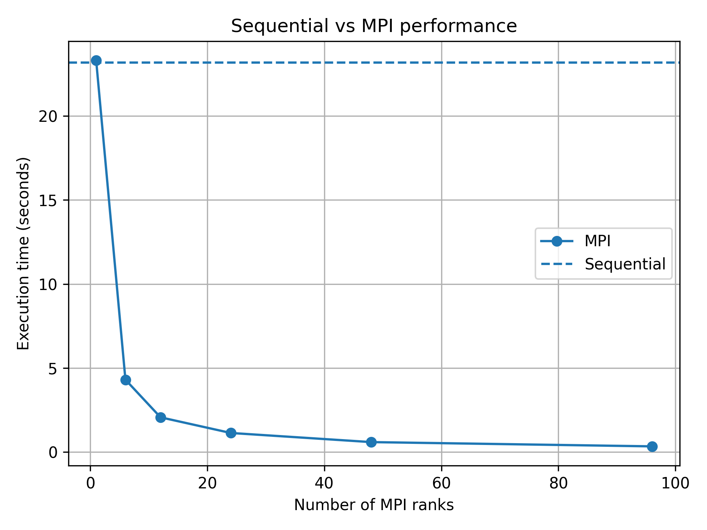

# Assignment 02

## Exercise 1

### Effects and implications of the parallelization

- MPI divides the samples among the ranks
- each rank independently generates points and counts those inside the circle
- the only communication is a final `MPI_Reduce` that sums the local counts of the ranks
- the seq version takes ~23.18 seconds (on lcc3) and ~14 seconds on my laptop, while 96 MPI ranks take ~0.333 seconds
- approximate speedup of 69.6 (from seq to 96 cores)
- the random seed heavily influences the generated samples and therefore the estimate of pi
    - repeating the run with the same base seed, sample count, and number of ranks produces the same result -> deterministic
- MPI with one rank is slightly slower than the sequential version due to MPI initialization and reduction overhead
- scaling becomes less efficient at higher rank counts because synchronization, reduction, startup costs, and shared-resource contention become more significant
- work is balanced using a quotient and remainder (goated), so extra samples are assigned to the first ranks
- MPI is most effective for large sample counts
- adding more ranks eventually stops providing reasonable speedups
