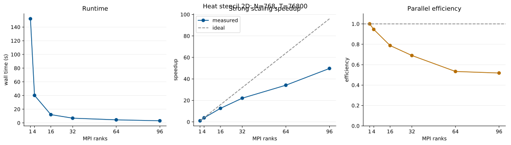
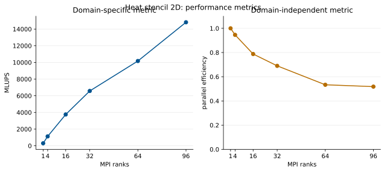

# Assignment 04

## Exercise 1

I chose strong scalability because:
- it allows to measure exec time, speedup and para. efficiency consistently
- testing with several fixed problem sizes also allows to see if the program scales consistently for both smaller and large grids
- weak scaling would increase workload which makes direct comparisons less meaningful

### Further questions

<span style="color:lightgreen">*Illustrate the data in appropriate figures and discuss them. What can you observe?*</span>

strong-scaling results for `N=768` and `T=76800`:



| MPI ranks | Runtime (s) | Speedup | Efficiency |
|---:|---:|---:|---:|
| 1 | 152.106 | 1.00 | 100.0% |
| 4 | 40.205 | 3.78 | 94.6% |
| 16 | 12.068 | 12.60 | 78.8% |
| 32 | 6.890 | 22.08 | 69.0% |
| 64 | 4.455 | 34.15 | 53.4% |
| 96 | 3.057 | 49.75 | 51.8% |

- The runtime decreases significantly as more MPI ranks are used.
- Scaling is nearly ideal up to 4 ranks, but speedup becomes increasingly sublinear afterwards.
- Efficiency drops from 94.6% with 4 ranks to 51.8% with 96 ranks. 
    - Likely because MPI communication and synchronization becomes more expensive relative to computation.
    - Increasing from 64 to 96 ranks provides almost no returns: the speedup improves by only a factor of 1.46.

<span style="color:lightgreen">*Measure and illustrate one domain-specific and one domain-inspecific performance metric. What can you observe?*</span>

domain-specific metric is **MLUPS** (million lattice updates per second):

```text
MLUPS = N² · T / runtime / 10⁶
```

It measures the amount of heat-stencil work completed per second. 

domain-independent metric is **parallel efficiency**, calculated as speedup divided by the number of MPI ranks. .

| MPI ranks | MLUPS | Parallel efficiency |
|---:|---:|---:|
| 1 | 297.8 | 100.0% |
| 4 | 1126.7 | 94.6% |
| 16 | 3753.5 | 78.8% |
| 32 | 6574.7 | 69.0% |
| 64 | 10169.1 | 53.4% |
| 96 | 14816.2 | 51.8% |

- The increase of MLUPS is not proportional to the rank count
    - 96 ranks provide 49.75 times the single-rank throughput instead of the ideal factor of 96
- Reflected by the decreasing parallel efficiency, which falls below 55% at 64 and 96 ranks
- So, adding ranks still improves absolute performance, but communication and synchronization increasingly limit the useful fraction of the available computational capacity


<span style="color:lightgreen">*How can you verify the correctness of your applications?*</span>

- The sequential implementation can be used as a reference for small problem sizes
- run both implementations with the same `N` and `T` and compare the resulting temperature fields cell by cell
- This should be repeated with different numbers of MPI ranks

Both programs also perform an internal sanity check: every final temperature must remain between the ambient temperature of `273 K` and the source temperature of `333 K`. The MPI program combines the local results with `MPI_Reduce`, so rank 0 reports `Verification: OK` only if every process passes this check. The runs in `heat_stencil_2D_mpi.log` all reported `Verification: OK`.

## Exercise 2