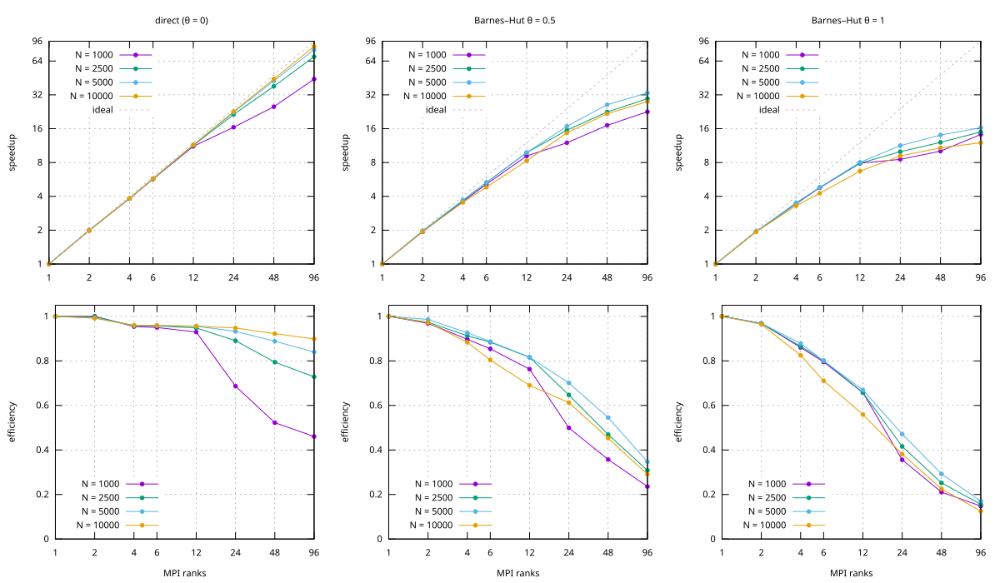
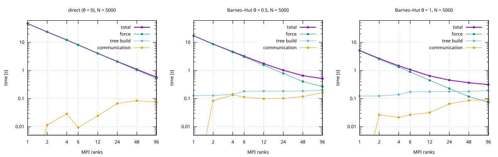

# Assignment 06

## Exercise 1

Setup:
- strong scaling on LCC3 (12 cores per node, so 96 ranks = 8 nodes), 100 timesteps
- each value is the fastest of 3 runs
- three variants of [`nbody_mpi.c`](nbody_mpi.c), selected by the opening angle `θ`, so the optimization can be measured separately from the parallelization:
    - `θ = 0`: direct `O(N²)` summation, i.e. the Assignment 5 algorithm with MPI only
    - `θ = 0.5`: Barnes–Hut, the usual accuracy setting
    - `θ = 1.0`: Barnes–Hut, faster but less accurate
- the 1-rank direct run is the sequential baseline
- raw data: [`nbody_bench_partial.csv`](nbody_bench_partial.csv); figures: [`plot_benchmark.plt`](plot_benchmark.plt)
- the `N = 10000` runs are incomplete (the job stopped after 6 ranks of the direct variant)

#### What is the speedup and efficiency for multiple problem and machine sizes?

Best 96-core wall time for 5000 particles and 100 timesteps: **0.300 s** with `θ = 1` (0.448 s with `θ = 0.5`).

#### Illustrate the data in appropriate figures and discuss them. What can you observe? Did the implementation meet your expectations from Assignment 5? 

The breakdown shows the slowest rank's time per phase: force computation, tree build (replicated on every rank), and `MPI_Allgatherv` communication (including waiting for slower ranks).

**Direct summation (MPI only)**
- Scales almost ideally within one node: ≥ 92% efficiency up to 12 ranks for all `N`.
- Beyond one node (24+ ranks), communication goes over the network and efficiency drops, most for small `N` (48% at `N = 1000` with 96 ranks).
- Larger problems scale better: 48% → 73% → 84% efficiency at 96 ranks for `N` = 1000 → 2500 → 5000.
    - force work per rank is `O(N²/P)`, while the `Allgatherv` moves `O(N)` data
    - so the ratio of computation to communication grows with `N`
- This matches the Assignment 5 prediction for the 1D particle decomposition.

**Barnes–Hut (optimization)**
- On one rank it cuts the runtime, and the gain grows with `N` as expected from `O(N log N)` vs. `O(N²)`:
    - `θ = 0.5`: 1.0× (`N = 1000`), 2.2× (2500), 2.7× (5000) faster than direct
    - `θ = 1`: 2.3×, 6.2×, 9.0× faster
- At `θ = 0.5` the gain is smaller than hoped for these problem sizes:
    - every particle still interacts with many cells
    - and tree traversal (recursion, scattered memory accesses) costs more per interaction than the simple, vectorizable direct loop
- The Barnes–Hut runtime also grows faster with `N` than `N log N` would suggest (`θ = 0.5`: ×3.2 from 2500 to 5000).
    - all particles have unit mass, so a larger `N` means a heavier system that collapses more strongly
    - this gives denser clusters and a deeper tree, so the problems are not physically the same

**Barnes–Hut + MPI**
- Scales much worse than direct summation: 40% (`θ = 0.5`) and 18% (`θ = 1`) efficiency at 96 ranks for `N = 5000`.
- Main reason: every rank builds the **whole tree**. This part is not parallelized.
    - it stays at about 0.13–0.19 s however many ranks are used
    - at 96 ranks it accounts for 41% (`θ = 0.5`) and 60% (`θ = 1`) of the total runtime (Amdahl's law)
    - it even gets slower once a node is full (0.13 s → 0.19 s between 1 and 12 ranks), because 12 ranks building the same tree at once compete for memory bandwidth and the shared cache
- Communication takes about 0.1 s at 96 ranks for every variant. It matters more for Barnes–Hut because there is less computation to hide it behind.
- The cheaper the computation (larger `θ`), the larger the share of these fixed costs, so the worse the efficiency.
- Even so, the combination gives the shortest absolute runtimes: 104× (`θ = 0.5`) and 155× (`θ = 1`) faster than the 1-rank direct version at 96 ranks, compared with 81× for MPI alone.

**Expectations from Assignment 5**
- The direct MPI version met them: the 1D decomposition with `MPI_Allgatherv` balances well and scales well, and communication becomes the limiting factor for small `N` and many ranks.
- Barnes–Hut delivered the expected reduction in work, but less than expected at `θ = 0.5` and `N ≤ 5000`.
- The replicated tree build turned into a sequential bottleneck that Assignment 5 did not anticipate.
    - Assignment 5 noted that Barnes–Hut fits a spatial decomposition, where each rank builds only its part of the tree and exchanges summarized tree data
    - the simpler replicated design was chosen here, and the measurements show its cost
    - a distributed tree build would be the next step to improve scalability

## Exercise 2

Setup:
- [`nbody_mpi_ex2.c`](nbody_mpi_ex2.c) is `nbody_mpi.c` plus a 4th argument for the initial distribution (all velocities start at 0 in both cases):
    - `uniform`: positions uniformly in `[0, 100]³`, i.e. exactly the Exercise 1 case (the output is bit-identical to `nbody_mpi.c`)
    - `corner`: the same random numbers scaled into `[0, 10]³`, i.e. all particles in one corner, extending 10% in each dimension
- it also reports the **load imbalance** of the force phase: `max over ranks / average over ranks` (1.0 = perfectly balanced)
- [`benchmark_ex2.slurm`](benchmark_ex2.slurm) runs both distributions with `θ = 0, 0.5, 1` for `N = 5000`, 100 timesteps, 1–96 ranks (fastest of 3 runs)
- figure: [`plot_ex2.plt`](plot_ex2.plt), raw data: _TODO `nbody_ex2_<jobid>.csv`_

#### Compare the performance to that of Exercise 1, how are speedup and efficiency affected?

_TODO: fill in from the cluster run (`N = 5000`, 96 ranks)._

| θ | distribution | time (s) | speedup | efficiency | imbalance |
|---:|---|---:|---:|---:|---:|
| 0 | uniform | | | | |
| 0 | corner | | | | |
| 0.5 | uniform | | | | |
| 0.5 | corner | | | | |
| 1 | uniform | | | | |
| 1 | corner | | | | |

Best 96-core wall time for 5000 particles and 100 timesteps: _TODO_

Why the corner case causes (almost) no load imbalance in this implementation:
- work is distributed by **particle index**, not by **space**: rank `r` owns a contiguous block of indices
- positions are random, so each block is a random sample of the whole distribution, in both cases
    - in the corner case every rank gets particles from the same dense cube, so every rank does about the same work
- direct summation: every particle needs exactly `N − 1` interactions wherever it is, so the work per rank cannot depend on the positions at all
- Barnes–Hut: the cost per particle does depend on its surroundings, but these differences average out over a random sample of ~50 or more particles per rank
- first local test (4 ranks, `N = 5000`): the imbalance stayed ≤ 1.03 for both distributions and all `θ`

What changes instead is the **total** amount of work:
- the corner cube is 10× smaller, so initial distances are 10× smaller and accelerations (`∝ 1/r²`) 100× larger
- with `dt = 1` the cluster collapses and particles get flung apart much more violently in the first steps, so the particle distribution, and with it the tree, develops differently
- this changes the Barnes–Hut cost for every rank equally (locally the corner case was faster for `θ > 0`). Direct summation does the same number of interactions in both cases
- since all ranks are affected equally, speedup and efficiency (relative to 1 rank of the same distribution) should stay close to Exercise 1

Comparison with a spatial decomposition:
- had each rank owned a fixed region of space (e.g. 96 slabs of `[0, 100]` along `x`), the corner case would put all particles into the ~10 slabs that cover `[0, 10]`
- those ~10 ranks would do all the work while the other ~86 idle: an imbalance of about 10, capping the speedup at about 10
- the index-based decomposition avoids this by design; the price is that a rank's particles are not close in space, which would matter for a distributed tree (see Exercise 1)
